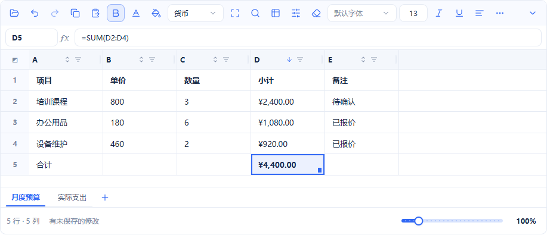
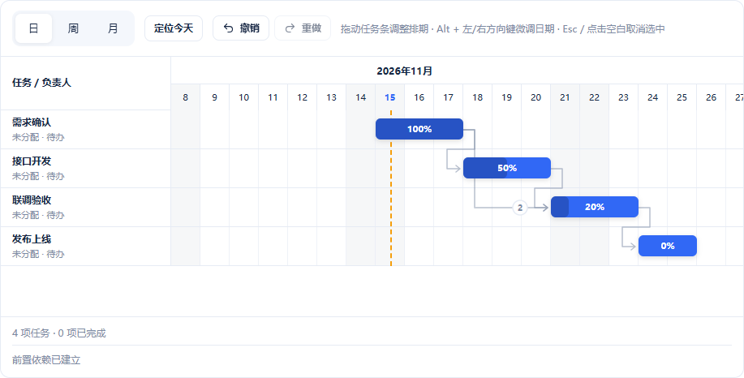
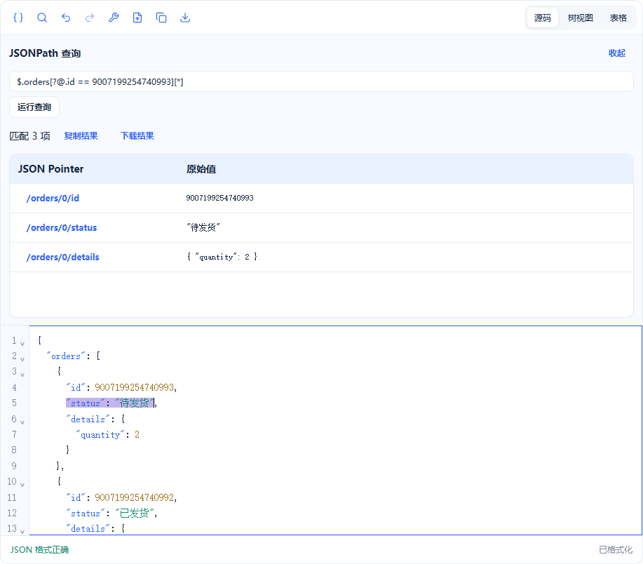
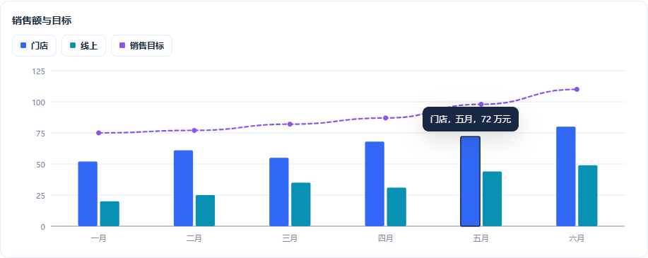

# HYS UI

HYS UI 是面向管理后台和业务工作台的 Vue 3 组件库。用它可以搭建筛选表单、数据列表和审批界面，也可以在同一个应用中嵌入带公式和 Excel 文件交换的电子表格、支持依赖调整的甘特图，以及 Markdown 和 JSON 编辑器。组件支持 ESM 按需导入、TypeScript 类型提示和主题定制。

[在线文档与交互示例](https://lampo1024.github.io/hys-ui/) · [快速开始](#快速开始) · [高级能力](#高级能力) · [表格选型](#数据表格怎么选)

`0.13.0` 改用内置 SVG 图标，按需加载 Markdown 预览和表单校验，并提供基础包与四个可独立安装的功能包。[npm](https://www.npmjs.com/package/hys-ui) · [更新记录](packages/ui/CHANGELOG.md)

## 功能截图

### 电子表格 · 预算工作簿

按小计降序排列明细后，可在公式栏查看合计单元格的 SUM 公式。底部标签可在月度预算和实际支出之间切换。[试用电子表格](https://lampo1024.github.io/hys-ui/components/hys-spreadsheet/#scene-basic)



### 甘特图 · 排期与依赖

沿时间轴调整任务日期，从连线查看前置依赖。新增或调整依赖后可撤销。[试用甘特图](https://lampo1024.github.io/hys-ui/components/hys-gantt/#scene-history)



### JSON 编辑器 · 精确查询

用 JSONPath 按大整数订单号筛选字段，点击结果路径可跳回源码并高亮对应位置。[试用 JSON 编辑器](https://lampo1024.github.io/hys-ui/components/hys-json-editor/#scene-responsetools)



### 图表 · 柱线组合

并排柱体对比门店和线上销售额，虚线标出销售目标。悬停柱体可查看当月数值。[试用柱线组合图](https://lampo1024.github.io/hys-ui/components/hys-chart/#scene-series)



## 快速开始

适用于 Vue 3.5+ 浏览器应用。通过 ESM 命名导入使用组件，无需全局注册或安装 Vue Router。

```bash
npm install hys-ui
```

把下面的任务状态选择示例放到任意 Vue 页面即可运行。项目中可以把 `hys-ui/style.css` 移到应用入口统一导入。

```vue
<script setup lang="ts">
import { ref } from 'vue'
import { HysSelect } from 'hys-ui'
import 'hys-ui/style.css'

const status = ref('all')
const options = [
  { label: '全部状态', value: 'all' },
  { label: '待办', value: 'todo' },
  { label: '进行中', value: 'in-progress' },
  { label: '已完成', value: 'done' },
]
</script>

<template>
  <HysSelect v-model="status" :options="options" aria-label="任务状态" />
  <p>当前状态值：{{ status }}</p>
</template>
```

## 按需安装

完整组件库使用 `hys-ui`。如果项目只需要常用控件，可以选择 `hys-ui-core`。基础包包括表单、表格、甘特图、图表、富文本和电子表格。它的额外运行时依赖是表单校验器和富文本清理器。

| 功能包 | 接入方式 |
| --- | --- |
| `hys-ui-markdown` | 导入 `HysMarkdownEditor`。 |
| `hys-ui-json` | 导入 `HysJsonEditor`，包含 JSON Schema、修复、YAML 转换等工具。 |
| `hys-ui-xlsx` | 调用 `createSpreadsheetExcelFormat()`，将返回值放入 `HysSpreadsheet` 的 `file-formats`。 |
| `hys-ui-pinyin` | 将 `loadMentionPinyin` 传给 `HysMention` 的 `pinyin-loader`，并选择 `pinyin` 或 `initials` 匹配。 |

基础包和功能包使用同一版本。例如，为 Vue 项目安装基础包和 Excel 读写包。

```bash
npm install hys-ui-core@0.13.0 hys-ui-xlsx@0.13.0
```

```vue
<script setup lang="ts">
import { HysSpreadsheet } from 'hys-ui-core'
import { createSpreadsheetExcelFormat } from 'hys-ui-xlsx'
import 'hys-ui-core/style.css'
import 'hys-ui-core/pro-grid.css'
import 'hys-ui-core/pro-grid/clipboard.css'

const fileFormats = [createSpreadsheetExcelFormat()]
</script>

<template>
  <HysSpreadsheet :file-formats="fileFormats" />
</template>
```

运行 `npm run pack:features` 可在 `artifacts/` 生成同版本的本地压缩包。运行 `npm run check:features` 可验证独立安装、类型声明、主题继承及 Excel 往返。

## 高级能力

### 电子表格与项目排期

- **`HysSpreadsheet` 电子表格**支持多工作表、跨表公式、选区批量编辑和冻结行列。可用日期、下拉或多选等单元格编辑器录入数据，再拖拽填充序列、选择性粘贴、排序和筛选明细。工作簿支持 Excel `.xlsx` 和 JSON 导入导出。[试用类型化编辑](https://lampo1024.github.io/hys-ui/components/hys-spreadsheet/#scene-cellediting) · [试用 Excel 导入导出](https://lampo1024.github.io/hys-ui/components/hys-spreadsheet/#scene-excelexchange)
- **`HysGantt` 甘特图**支持拖动任务、调整工期、连接和重连任务依赖。修改前可查看排期冲突，修改后可撤销重做。任务较多时可以使用虚拟列表。[预览排期冲突](https://lampo1024.github.io/hys-ui/components/hys-gantt/#scene-conflictpreview) · [试用大数据排期](https://lampo1024.github.io/hys-ui/components/hys-gantt/#scene-largedata)

### 文档编辑与 JSON 工具

- **`HysJsonEditor`**适合排查配置和检查 API 响应。源码有语法高亮，树节点可全部展开或折叠，对象数组可切换到虚拟表格。格式化保留数字原文（含大整数和高精度小数）、键顺序和重复键。修复前可预览差异，重复键可定位并删除指定副本。[试用配置排错](https://lampo1024.github.io/hys-ui/components/hys-json-editor/#scene-configurationtools)
- **JSON 校验与查询**支持 Draft 7 和 2020-12 Schema、文档内 `$ref` 和错误定位。可用 JSONPath 查询字段和数组项，按原始数字精度比较，也可按字段比较两份 JSON 的结构差异。Schema 校验遇到 JavaScript 无法无损表示的数字时，会提示受影响的字段。[试用响应检查](https://lampo1024.github.io/hys-ui/components/hys-json-editor/#scene-responsetools)
- **JSON 整理与转换**支持排序、去重、CSV 和 YAML 双向转换，以及从样本生成 TypeScript 类型。转换结果可以先预览，再复制、下载或应用到源码。[试用数据转换](https://lampo1024.github.io/hys-ui/components/hys-json-editor/#scene-conversiontools)
- **`HysMarkdownEditor`**提供源码、分栏和实时预览模式，支持 GFM 表格和任务清单、标题大纲、查找替换、`.md` 导入导出。点击预览中的任务复选框可同步更新源码。[试用 Markdown 项目文档](https://lampo1024.github.io/hys-ui/components/hys-markdown-editor/#scene-projectdocument)
- **`HysRichTextEditor`**适合以 HTML 保存公告和正文。支持常用文字与段落格式，可清理从外部粘贴的内容。[试用 HTML 段落工具](https://lampo1024.github.io/hys-ui/components/hys-rich-text-editor/#scene-blocktools)

### 数据可视化与多任务工作台

- **`HysChart` 图表**提供柱状、横向条形、折线、面积、饼图、环形、散点和组合图。多系列可分组或堆叠，可通过图例切换数据系列、悬停查看数值、用键盘选择数据点，也可用参考线标出目标值。[试用多系列图表](https://lampo1024.github.io/hys-ui/components/hys-chart/#scene-series) · [试用参考线](https://lampo1024.github.io/hys-ui/components/hys-chart/#scene-referenceline)
- **`HysTabs` 标签页**可用于同时打开多条业务记录，支持固定和拖拽标签、切换守卫、异步加载、路由同步和会话恢复。**`HysSortableList`**支持跨列表与层级移动、批量排序、克隆、虚拟列表和异步保存失败回滚。[试用多标签工作台](https://lampo1024.github.io/hys-ui/components/hys-tabs/#scene-workbench) · [试用树形拖拽](https://lampo1024.github.io/hys-ui/components/hys-sortable-list/#scene-tree)
- **`HysCard` 和 `HysScrollbar`**可用于需要聚焦查看的大面板。卡片支持带过渡的全屏切换，滚动条默认在悬停时显示，支持双向拖动、滚动到指定位置和触边加载。[试用卡片全屏](https://lampo1024.github.io/hys-ui/components/hys-card/#scene-fullscreen) · [试用滚动触边加载](https://lampo1024.github.io/hys-ui/components/hys-scrollbar/#scene-edgeloading)

## 数据表格怎么选

| 你的任务 | 组件 | 主要能力 |
| --- | --- | --- |
| 展示业务列表或树形明细 | `HysTable` | 固定列、展开行、合并单元格、表尾汇总和分页。[试用基础表格](https://lampo1024.github.io/hys-ui/components/hys-table/) |
| 对业务数据执行多列查询和整理 | `HysDataGrid` | 服务端查询、分组小计、列显隐、列布局预设和 CSV 导出。[试用列布局](https://lampo1024.github.io/hys-ui/components/hys-data-grid/#scene-columnlayouts) |
| 连续浏览大量数据或宽表 | `HysVirtualTable` | 按视口渲染行和列、固定行列、滚动加载。[试用宽表列虚拟化](https://lampo1024.github.io/hys-ui/components/hys-virtual-table/#scene-wide) |
| 逐条编辑、校验并保存业务记录 | `HysProGrid` | 类型化单元格编辑、异步校验、保存重试，可选剪贴板和条件格式。[试用预算审批](https://lampo1024.github.io/hys-ui/components/hys-pro-grid/#scene-budgetapproval) |
| 编辑多工作表、计算公式并交换 Excel 文件 | `HysSpreadsheet` | 跨表公式、选区操作、序列填充、行列冻结和工作簿导入导出。[试用预算工作簿](https://lampo1024.github.io/hys-ui/components/hys-spreadsheet/#scene-basic) |

使用 `HysProGrid` 或 `HysSpreadsheet` 时，在基础样式之外引入 `hys-ui/pro-grid.css`。电子表格示例同时引入 `hys-ui/pro-grid/clipboard.css`。ProGrid 的剪贴板和条件格式可以按需从 `hys-ui/pro-grid/clipboard` 和 `hys-ui/pro-grid/conditional-format` 接入，并引入对应的 `.css`。[剪贴板接入示例](https://lampo1024.github.io/hys-ui/components/hys-pro-grid/#scene-clipboard)

## 按场景找组件

在线文档的示例可直接操作。展开「查看示例源码」可复制 Vue 代码，属性、事件、插槽和实例方法见各组件的 API 参考。

| 场景 | 可以做什么 | 在线示例 |
| --- | --- | --- |
| 表单与输入 | 配置字段联动、异步校验、远程搜索和多选。 | [表单异步校验](https://lampo1024.github.io/hys-ui/components/hys-form/#scene-async) · [下拉选择](https://lampo1024.github.io/hys-ui/components/hys-select/) · [自动补全](https://lampo1024.github.io/hys-ui/components/hys-autocomplete/) |
| 层级与批量选择 | 按层级挑选分类，在两侧列表之间批量移动成员。 | [树形选择](https://lampo1024.github.io/hys-ui/components/hys-tree-select/) · [穿梭框](https://lampo1024.github.io/hys-ui/components/hys-transfer/) |
| 日期与筛选 | 选择日期或日期时间范围，配置快捷预设、禁用日期和双面板。 | [日期选择](https://lampo1024.github.io/hys-ui/components/hys-date-picker/) · [日期范围](https://lampo1024.github.io/hys-ui/components/hys-date-range-picker/) |
| 弹层与反馈 | 在对话框中编辑长表单，用抽屉查看详情，用轻提示反馈操作结果。 | [对话框](https://lampo1024.github.io/hys-ui/components/hys-modal/) · [抽屉](https://lampo1024.github.io/hys-ui/components/hys-drawer/) · [轻提示](https://lampo1024.github.io/hys-ui/components/hys-toast/) |
| 文件与进度 | 控制上传队列，接入业务上传请求，显示进度、失败和重试状态。 | [自定义上传请求](https://lampo1024.github.io/hys-ui/components/hys-upload/#scene-request) · [进度条](https://lampo1024.github.io/hys-ui/components/hys-progress/) |
| 运维与开发工具 | 校验 Cron 表达式并预览执行时间，搜索常用命令，逐行比较配置差异。 | [Cron 执行预览](https://lampo1024.github.io/hys-ui/components/hys-cron-editor/#scene-runpreview) · [命令面板](https://lampo1024.github.io/hys-ui/components/hys-command-palette/#scene-recentcommands) · [文本差异](https://lampo1024.github.io/hys-ui/components/hys-diff-viewer/#scene-contextreview) |

## 用 JSON Schema 编辑配置

下面的示例把重试次数限制在 0 至 5。打开底部的 Schema 问题列表，点击错误可定位到 `retries`，改成 `3` 即可通过校验。`v-model` 始终保存 JSON 源码，切换视图后仍可以读取同一份文本。[完整配置排错示例](https://lampo1024.github.io/hys-ui/components/hys-json-editor/#scene-configurationtools)

```vue
<script setup lang="ts">
import { ref } from 'vue'
import { HysJsonEditor, type HysJsonEditorSchema } from 'hys-ui'
import 'hys-ui/style.css'

const json = ref('{\n  "region": "east",\n  "retries": 7\n}')
const schema = ref<HysJsonEditorSchema | null>({
  type: 'object',
  required: ['region', 'retries'],
  properties: {
    region: { enum: ['east', 'west'] },
    retries: { type: 'integer', minimum: 0, maximum: 5 },
  },
})
</script>

<template>
  <HysJsonEditor v-model="json" v-model:schema="schema" />
</template>
```

## 用轻提示反馈操作结果

在组件的 `<script setup>` 里调用 `useHysToast()`，即可在保存、上传等操作后显示提示。下面用定时器模拟上传，完成后更新同一条消息。

```vue
<script setup lang="ts">
import { ref } from 'vue'
import { HysButton, useHysToast } from 'hys-ui'
import 'hys-ui/style.css'

const toast = useHysToast()
const uploading = ref(false)

async function simulateUpload() {
  uploading.value = true
  const message = toast.loading('正在上传…')

  await new Promise(resolve => setTimeout(resolve, 700))

  message.update({ type: 'success', message: '上传完成', duration: 2000 })
  uploading.value = false
}
</script>

<template>
  <HysButton :loading="uploading" @click="simulateUpload">模拟上传</HysButton>
</template>
```

轻提示默认在顶部居中。可设置显示位置、停留时长和队列上限，也可以合并重复消息。[轻提示 API 与示例](https://lampo1024.github.io/hys-ui/components/hys-toast/)

## 主题与动效

在根组件的 `<script setup>` 中调用 `provideHysConfig`，下级组件及其浮层会继承配置。主题支持响应式切换。

```ts
import { ref } from 'vue'
import { provideHysConfig, type HysTheme } from 'hys-ui'

const theme = ref<HysTheme>('blue')
provideHysConfig({ theme, motion: 'subtle' })
```

内置主题有 `blue`、`dark`、`green`、`purple`、`orange` 和 `forest`。可用 `--hys-ui-primary`、`--hys-ui-surface` 等 CSS 变量调整外观。动效可设为 `full`、`subtle` 或 `off`，并遵循系统的减少动态效果设置。支持浮层动效的组件还可以单独设置 `popup-transition` 和 `popup-transition-duration`。

## 本地开发

仓库使用 npm workspaces。`packages/ui` 存放组件源码，`apps/docs` 存放文档和示例。使用 Node.js 22 启动文档。

```bash
npm ci
npm run dev:docs
```

开发站点默认监听 [127.0.0.1:5174](http://127.0.0.1:5174/)。

| 命令 | 用途 |
| --- | --- |
| `npm run build:ui` | 构建组件包和类型声明 |
| `npm run build:docs` | 构建文档到 `apps/docs/dist` |
| `npm test` | 运行组件回归测试 |
| `npm run check:contracts` | 检查组件导出和文档完整性 |
| `npm run check:release` | 检查构建、测试、打包与独立安装 |

推送到 `main` 会触发 [GitHub Pages 部署](.github/workflows/docs-pages.yml)。npm 发布通过 [`npm run release:ui`](scripts/release.mjs) 执行，脚本会发布通过检查的压缩包并核对 registry 上的完整性。

## 问题反馈

提交问题时，可以附上 Vue 和 hys-ui 版本、复现步骤，以及能复现问题的代码或示例链接。[GitHub Issues](https://github.com/lampo1024/hys-ui/issues)

## 许可证

[MIT](LICENSE)
